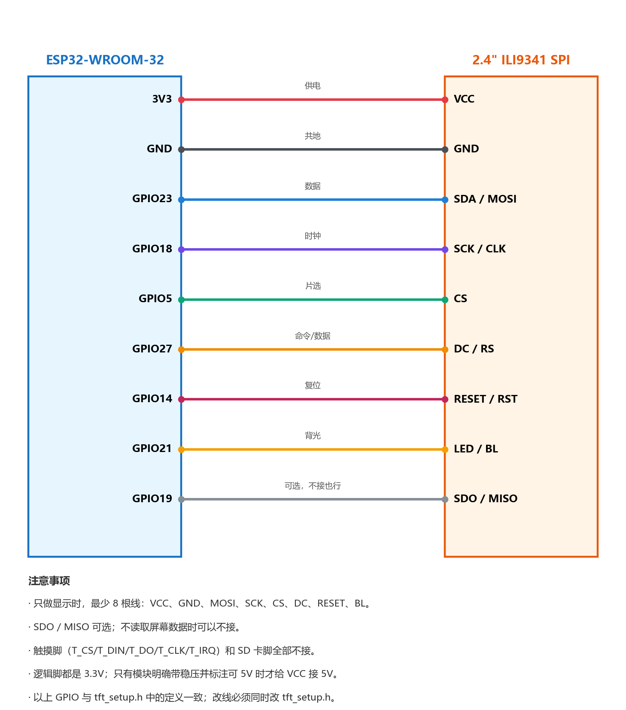

# ESP32 绝区零信息显示屏

用一块 ESP32 + 2.4 寸 SPI 液晶屏，做一个桌面上常亮的小显示器，实时显示**绝区零**的体力和战绩。

数据来自米游社的官方接口，不依赖游戏在线，手机电脑都不用开着。

## 功能

屏幕两页，每 8 秒自动轮换：

**第 1 页 · 电量与版本**

- 电量 / 满电量、还要多久回满
- 今日活跃度
- 录像带店状态、刮刮卡状态
- 下一次版本更新的倒计时和具体日期

**第 2 页 · 挑战战绩**

- 式舆防卫战：已通关层数、得分、本期截止日期
- 危局强袭战：总分、星数、排名百分比

底栏显示页码、当天日期和实时时钟。

## 硬件

| 物品 | 说明 |
|---|---|
| ESP32-WROOM-32 | 任意 ESP32 Dev Module 都行 |
| 2.4 寸 ILI9341 SPI 液晶屏 | 240×320，8 根排针那种 |
| 杜邦线 | 母对母 / 母对公 |
| USB 数据线 | 必须能传数据，只能充电的线不行 |

## 接线



| 屏幕引脚 | 接到 ESP32 | 作用 |
|---|---|---|
| `VCC` | `3V3` | 供电，**先用 3.3V** |
| `GND` | `GND` | 必须和 ESP32 共地 |
| `SDA` / `SDI` / `MOSI` | `GPIO23` | SPI 数据 |
| `SCK` / `SCL` / `CLK` | `GPIO18` | SPI 时钟 |
| `CS` | `GPIO5` | 片选 |
| `DC` / `RS` / `A0` | `GPIO27` | 命令/数据选择 |
| `RESET` / `RST` | `GPIO14` | 复位 |
| `LED` / `BL` / `BCKL` | `GPIO21` | 背光 |
| `SDO` / `MISO` | `GPIO19` | 可选，不接也能显示 |

不用接的：`T_CS`、`T_IRQ`、`T_DIN`、`T_DO`、`T_CLK`（触摸），
`SD_CS`、`SD_MOSI`、`SD_MISO`、`SD_SCK`（SD 卡）。

所以最少 8 根线就能跑：`VCC`、`GND`、`MOSI`、`SCK`、`CS`、`DC`、`RESET`、`BL`。

> 逻辑脚（`CS`/`DC`/`RST`/`MOSI`/`SCK`）**不要接 5V**，ESP32 是 3.3V 电平。
> 只有模块上明确带稳压芯片（如 AMS1117）时 `VCC` 才能接 5V。

改了接线的话，要同步改 `esp32_zzz_display/tft_setup.h` 里的 GPIO 编号。

## 快速开始

### 1. 装环境

1. **Arduino IDE** 2.x
2. **ESP32 开发板支持**：
   - `文件 → 首选项`，附加开发板管理器地址填
     `https://espressif.github.io/arduino-esp32/package_esp32_index.json`
   - `工具 → 开发板 → 开发板管理器`，搜 `esp32`，装 `esp32 by Espressif Systems`
3. **两个库**（`工具 → 管理库`）：
   - `TFT_eSPI`（作者 Bodmer）
   - `ArduinoJson`（作者 Benoit Blanchon）

### 2. 配好 config.h

把模板复制成实际配置：

```bash
cd esp32_zzz_display
copy config.example.h config.h    # Windows
cp config.example.h config.h      # Linux / macOS
```

然后编辑 `config.h`，最少要填这几项：

```cpp
constexpr char kWifiSsid[]  = "你的Wi-Fi名称";   // 只能 2.4GHz
constexpr char kWifiPassword[] = "你的Wi-Fi密码";
constexpr char kStuid[]  = "你的stuid";
constexpr char kStoken[] = "你的stoken";
constexpr char kMid[]    = "你的mid";
constexpr char kZzzRoleId[] = "你的9位UID";
```

`config.h` 已经被 `.gitignore` 忽略，填真实账号也不会被提交。

> **米游社凭据怎么拿**：看 [docs/配置说明.md](docs/配置说明.md) 第三节。
> 简短版：米游社的接口只认 App 端登录产生的 `stoken`，网页版 Cookie 不行
> （会返回 `-100 请先登录`）。用扫码登录工具拿 `stuid` / `mid` / `stoken` 三项即可。

> **校园网用户**：如果连上 Wi-Fi 还要开浏览器登录，才需要填 `kPortalHost` 等三项；
> 家用 Wi-Fi 保持空字符串，固件会自动跳过门户认证。

### 3. 烧录

1. Arduino IDE 打开 `esp32_zzz_display/esp32_zzz_display.ino`
2. `工具 → 开发板` 选 **ESP32 Dev Module**
3. `工具 → 端口` 选你的 COM 口
4. 点上传

上传完打开 `工具 → 串口监视器`，波特率 **115200**，编码改成 **UTF-8**。

正常的输出大概是这样：

```text
=== 绝区零显示屏启动 ===
[网络] 正在连接 你的Wi-Fi名称
[网络] 已连接 IP=192.168.1.23 信号=-55 dBm
[网络] 外网可用，跳过门户认证
[时间] 已同步 2026-10-14 15:00:54
[实时便笺] 电量=188/240 回满=5时11分(18681秒) 活跃度=0/400 录像带店=待结算 刮刮卡=未刮
[式舆防卫战] 层数=3 得分=0/150000 截止=10-16
[危局强袭战] 得分=9936/195000 星数=1/3 排名=9821
[版本更新] 更新时间=2026-10-21 06:00 剩余=6天12时
=== 首轮数据读取完成，屏幕开始轮换两页（可用内存 187000 字节）===
```

## 刷新频率

| 数据 | 间隔 |
|---|---|
| 电量、活跃度、录像带店、刮刮卡 | 5 分钟 |
| 式舆防卫战、危局强袭战 | 30 分钟 |
| 版本更新公告 | 6 小时 |
| 屏幕重绘（刷新倒计时） | 30 秒 |
| 页面轮换 | 8 秒 |
| Wi-Fi 断线重连 | 20 秒 |

## 常见问题

**屏幕背光亮着，但什么都没有**

1. 检查 `CS`、`DC`、`RESET` 是否接错
2. 屏幕和 ESP32 必须共地
3. 花屏：把 `tft_setup.h` 里的 `SPI_FREQUENCY` 从 `27000000` 降到 `20000000`
4. 红蓝反色：把 `tft_setup.h` 里的 `TFT_RGB_ORDER` 改成 `TFT_RGB`

**串口一直"正在连接"，连不上 Wi-Fi**

- 确认是 2.4GHz 的 SSID，大小写完全一致
- 路由器开了「AP 隔离」的话连不上，先关掉

**`[实时便笺] 请求失败 retcode=-100`**

`stoken` 不对或已失效，重新扫码获取后更新 `config.h`。

**`[危局强袭战] 请求失败 ...` 或屏幕第 2 页显示 `--`**

危局接口的响应比式舆大（约 2.5 KB，含角色明细和长文本）。程序已经用过滤器
只解析需要的字段，并且在解析前先关闭 TLS 连接以降低内存占用。
如果仍然失败，把串口里那行带「可用内存」的完整输出发出来。

**屏幕上某个汉字变成空心方块**

那是字模缺字。改完界面文字后重新生成字模：

```bash
python esp32_zzz_display/tools/gen_cjk_font.py
python esp32_zzz_display/tools/verify_cjk_coverage.py
```

第二条输出 `missing (none)` 就说明齐全了。

## 目录结构

```text
.
├── README.md
├── docs/
│   └── 配置说明.md                 详细的配置步骤（含米游社凭据获取）
└── esp32_zzz_display/              ← Arduino IDE 打开这个文件夹里的 .ino
    ├── esp32_zzz_display.ino       主程序
    ├── config.example.h            配置模板（复制成 config.h 后填自己的）
    ├── tft_setup.h                 ILI9341 引脚和 TFT_eSPI 参数
    ├── srun_portal.h               校园网深澜门户自动登录（家用 Wi-Fi 用不到）
    ├── cjk_font.h                  中文字模，自动生成，不要手改
    ├── 接线图-ILI9341.png
    └── tools/
        ├── gen_cjk_font.py         重新生成字模
        ├── verify_cjk_coverage.py  检查字模缺字
        ├── check_ino_structure.py  检查括号 / 预处理指令配对
        ├── draw_wiring.py          重新画接线图
        ├── pc_zzz_probe.py         电脑端验证凭据和各接口是否可用
        └── pc_device_bind_test.py  用真机设备信息测菲林月报（见下）
```

## 已知限制

**菲林月报（游戏内叫「绳网月报」）读不到**

接口 `api-takumi.mihoyo.com/event/nap_ledger/month_info` 对这个账号固定返回
`retcode 10041`。已经排除的原因：请求参数组合、Cookie 组合、接口路径、
设备指纹（含用真机参数换取的官方新指纹）、设备 ID，全都试过，症状不变。

对照组很说明问题：**体力接口用任意随机 device_id 都能读**，说明 10041 不是
"设备没绑定"，而是这个接口对该账号另有门槛。上游工具
[ZZZ-Plugin](https://github.com/ZZZure/ZZZ-Plugin) 的说法是需要在它的插件里
「绑定设备」（提交一台已登录米游社的安卓手机的设备参数），并且注明
「绑定设备**无法 100% 解决**账号异常」。

所以体力、战绩都能用，只有月报这条路暂时走不通。

## 致谢

- 接口签名规则参考了米游社社区通行做法
- 校园网深澜（Srun）门户登录算法参考了公开实现
- 设备绑定思路参考 [ZZZ-Plugin](https://github.com/ZZZure/ZZZ-Plugin)

## 许可

未声明许可证。如需他人自由使用，请自行补充（例如 MIT）。
